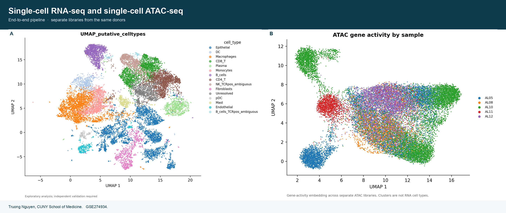

# scRNA-scATAC-seq_end2end




This is an end-to-end full pipeline for single-cell RNA-seq together with single-cell ATAC-seq. The worked example is GEO series [GSE274934](https://www.ncbi.nlm.nih.gov/geo/query/acc.cgi?acc=GSE274934), ALK-positive and wild-type lung adenocarcinoma. RNA and ATAC are separate single-cell libraries from the same donors. The two assays do not share cells, so there is no same-cell embedding and no peak-to-gene link.

**Truong Nguyen, CUNY School of Medicine.**

## What this run contains

Tumor type is the GEO sample characteristic `tumor type`.

| Donor | Tumor type | Single-cell RNA-seq | TCR | Single-cell ATAC-seq |
|---|---|---|---|---|
| AL02 | WT LUAD | yes | yes | no |
| AL03 | WT LUAD | yes | yes | no |
| AL04 | WT LUAD | yes | yes | no |
| AL05 | ALK-positive LUAD | yes | yes | yes |
| AL06 | ALK-positive LUAD | yes | yes | no |
| AL08 | WT LUAD | yes | yes | yes |
| AL10 | ALK-positive LUAD | yes | yes | yes |
| AL11 | WT LUAD | yes | yes | yes |
| AL12 | ALK-positive LUAD | yes | yes | yes |

- Single-cell RNA-seq QC retained 97,017 cells and 29,287 genes. Thresholds: 200 to 9,000 genes, mitochondrial fraction at most 25%.
- Scrublet expected doublet rate is 6%. A sample is `LOW_CONFIDENCE` when predicted doublets are under 10% of that expectation. AL12 is `COMPLETE` (515 doublets). The other eight donors are `LOW_CONFIDENCE`.
- TCR is joined before annotation. A non-T cluster with at least 20% productive TCR is relabelled `{label}_TCRpos_ambiguous`. This run: cluster 9 `NK_TCRpos_ambiguous` and cluster 13 `B_cells_TCRpos_ambiguous` (5,132 cells). Those labels stay in the object, the composition table, and the signature plots. They are not used as senders, receivers, target populations, or differential-expression groups.
- No batch correction. PCA uses 30 components, neighbors 15, Leiden resolution 0.6, seed 1234.
- Single-cell ATAC-seq QC, set before looking at retention: at least 1,000 fragments, at least 20% of fragments in peaks, and at least 15% of fragments in the Cell Ranger TSS region. That last value is a fragment fraction, not a TSS enrichment score. Cells kept: AL05 8,849/8,872, AL08 2,611/4,116, AL10 8,309/8,389, AL11 1,992/2,075, AL12 2,951/5,048.
- Each ATAC library has its own binarized TF-IDF LSI. LSI component 1 is dropped when |Spearman| with log10(fragments) is at least 0.5. Peak sets differ by sample and are not concatenated.
- Gene activity uses GENCODE v44 basic annotation, the longest transcript per gene, protein-coding and lncRNA genes, and a TSS window of ± 2,000 bp. A peak counts for every gene window it overlaps. The joint embedding is this gene-activity matrix (24,712 cells). Two of eight clusters are more than 90% one sample.
- The largest shared-barcode fraction between an RNA library and an ATAC library is 0.0004. Status `ATAC_RNA_cell_integration` is `NOT_APPLICABLE`.
- Donor-level Spearman of mean RNA versus mean gene activity: AL05 0.5379, AL08 0.3802, AL10 0.5572, AL11 0.4132, AL12 0.3501. This compares separate libraries from the same donor.
- ATAC between-condition differential accessibility is `NOT_TESTABLE`: 3 ALK-positive ATAC donors and 2 WT ATAC donors. The workflow requires at least 3 donors in each group. No peak-level test is implemented.
- RNA edgeR is an unpaired donor-level quasi-likelihood F test, one library per donor. Condition levels are sorted, so the contrast is `WT_LUAD vs ALK_positive_LUAD`. A positive logFC means higher in WT. Twelve marker labels were tested and each has 0 genes at FDR 0.05. That is the test result. `Unresolved`, `NK_TCRpos_ambiguous`, and `B_cells_TCRpos_ambiguous` are listed in `celltypes_not_tested.csv` and are not tested. Tested labels are still marker-based, so an FDR is not confirmed cell-type biology.

## Publication tables and figures

Ready-to-publish outputs are in `results/publication/`.

| File | Content |
|---|---|
| `figures/Figure1_single_cell_rna_and_atac.png` | Repository figure. Panel A is the single-cell RNA-seq UMAP. Panel B is the single-cell ATAC-seq gene-activity UMAP. |
| `figures/Figure1A_scrna_umap.pdf` | Vector panel A |
| `figures/Figure1B_scatac_gene_activity_umap.pdf` | Vector panel B |
| `tables/Table1_cohort.csv` through `Table8_cell_counts.csv` | Cohort, QC, barcode overlap, donor-level correlation, edgeR summary, labels not tested, and cell counts |
| `LEGENDS.md` | Figure and table legends |

The full figure set, PDF and PNG, is in `results/analysis/figures/`. The HTML report is `results/analysis/index.html`.

## Data

Series accession: **GSE274934**.

Series page: https://www.ncbi.nlm.nih.gov/geo/query/acc.cgi?acc=GSE274934

`inputs/GEO_SOURCE.tsv` lists every matrix the workflow reads, with the GEO file name, size, and SHA256. A file that is present in `inputs/` is included in this repository. Place any missing file in `inputs/` under the `short_name` in that table. GEO supplementary files use this URL pattern:

`https://ftp.ncbi.nlm.nih.gov/geo/samples/GSM8462nnn/{GSM}/suppl/{geo_filename}`

Two single-cell ATAC-seq peak matrices are above the GitHub file-size limit and are not in the repository:

| Place in `inputs/` | GEO file | Download |
|---|---|---|
| `AL05_atac_peaks.h5` | `GSM8462143_AL05_ATAC_filtered_peak_bc_matrix.h5` | https://ftp.ncbi.nlm.nih.gov/geo/samples/GSM8462nnn/GSM8462143/suppl/GSM8462143_AL05_ATAC_filtered_peak_bc_matrix.h5 |
| `AL10_atac_peaks.h5` | `GSM8462145_AL10_ATAC_filtered_peak_bc_matrix.h5` | https://ftp.ncbi.nlm.nih.gov/geo/samples/GSM8462nnn/GSM8462145/suppl/GSM8462145_AL10_ATAC_filtered_peak_bc_matrix.h5 |

`results/analysis/annotated_scrna.h5ad` is written by the pipeline. It is not stored in the repository. Rerun the workflow to create it. GENCODE v44 basic annotation is included at `pipeline/assets/gencode.v44.basic.annotation.gtf.gz`.

## Run on Ubuntu or macOS

Install Java 17 or newer, Nextflow, Python 3.10, and R with the Bioconductor package edgeR. Put `nextflow` and `Rscript` on `PATH`.

```bash
python3 -m venv pyenv
pyenv/bin/pip install -r pipeline/requirements.txt
chmod +x run_end2end.sh
./run_end2end.sh
```

On Ubuntu, `sha256sum` is used when `shasum` is absent. On macOS, `shasum` is used. Both check `inputs/SHA256SUMS.txt` for the original AL05 and AL06 RNA and TCR files. The full cohort check reads `inputs/GEO_SOURCE.tsv`.

Open `results/analysis/index.html` when the run finishes.

Docker, on either system:

```bash
RUNTIME=docker ./run_end2end.sh
```

`./run_end2end.sh download` is a separate fetch of AL05 and AL06 single-cell RNA-seq and TCR only. It does not run the ATAC libraries. The cohort command above is the end-to-end run.

From `pipeline/`:

```bash
python3 -m unittest tests.test_input_helpers -v
```

## Not run

SoupX or CellBender, scDblFinder, a reference-atlas annotation, copy-number or malignancy calling, SCENIC, CellChat, LIANA, NicheNet, motif enrichment, peak-level differential accessibility, BCR, CITE-seq, spatial data, response or survival analysis, external validation, and any same-cell model.
